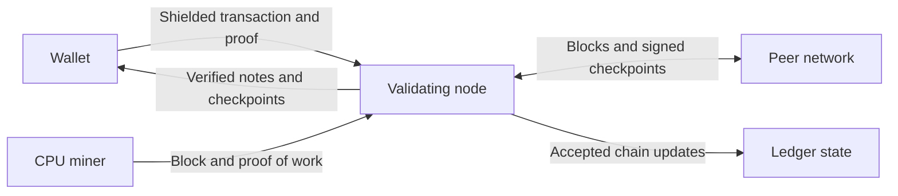

# SIWORLD

**Private by default. Post-quantum by design. Mined on everyday CPUs.**

SIWORLD is a Rust implementation of shielded multi-asset payments. The public
protocol uses native STARK proofs and RandomX proof of work.

[](https://github.com/howard1984/siworld/actions/workflows/ci.yml)
[](LICENSE)

[Whitepaper](docs/whitepaper.md) · [Protocol specifications](docs/README.md#protocol-specifications) · [Run a node](docs/guides/run-a-node.md) · [Mine on Linux](docs/guides/mine-on-linux.md) · [Exchange integration](docs/guides/exchange-integration.md)

## Protocol features

- **Shielded transfers conceal who paid whom, how much, and when the spent notes were received.**
- **ML-KEM-768 protects recipient data. ML-DSA-65 authenticates signed protocol messages.**
- **Native STARKs prove private state transitions without a trusted setup.**
- **RandomX proof of work runs on general-purpose CPUs.** ASERT adjusts difficulty.
- **Voyager and Holder spread new issuance over time** through distinct subsidy and locking rules.

See the [security model](docs/security/security-model.md) for the protocol's
cryptographic assumptions and observer model.

## Architecture

The diagram shows how participants interact under the public protocol. The
[specifications](docs/README.md#protocol-specifications) define the public
network rules.



## Build from source

Install Rust through rustup and use the pinned
[toolchain](rust-toolchain.toml). Install a C and C++ toolchain and CMake for
native dependencies. These commands build the checked-out source revision.
From the repository root, build the workspace and the native node library
with its peer and wallet gateway interfaces.

```sh
cargo build --workspace --locked
cargo build --release --locked --manifest-path crates/native-node/Cargo.toml \
  --features native-p2p,wallet-light-gateway --lib
```

See [Contributing](CONTRIBUTING.md#validation) for test and lint commands.

## Repository layout

| Path | Contents |
| --- | --- |
| [`crates/`](crates/) | Rust protocol, proof, node, wallet, and miner components |
| [`crates/native-node/`](crates/native-node/) | Native transaction and block validation, peer services, and state storage |
| [`crates/bench-multi-asset/`](crates/bench-multi-asset/) | Native transaction, issuance, and settlement proof relations |
| [`crates/native-wallet-engine/`](crates/native-wallet-engine/) | Wallet state, transaction construction, and light verification |
| [`docs/`](docs/README.md) | Whitepaper, specifications, operator guides, and parameter reference |
| [`scripts/`](scripts/) | Validation and reproducible build support |
| [`tools/explorer/`](tools/explorer/) | Read-only chain explorer |

## Public network

| Item | Availability |
| --- | --- |
| Network ID and address formats | [Protocol parameters](docs/reference/parameters.md) |
| Genesis ID | Published at network launch |
| Downloads and installation packages | Published at network launch |

Release information is available at [siworld.io](https://siworld.io/).

## Security and license

Report vulnerabilities through the [private disclosure process](SECURITY.md).
SIWORLD software is licensed under [GPL-3.0-only](LICENSE). See [NOTICE](NOTICE)
for third-party attribution.
