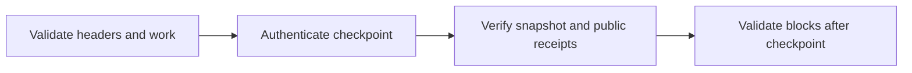

# 07. Storage and synchronization

| Field | Value |
| --- | --- |
| Title | 07. Storage and synchronization |
| Status | Active |
| Version | 1.0.0 |
| Applies to | SIWORLD public RandomX ruleset |
| Last updated | 2026-11-25 |

## Abstract

Defines authenticated checkpoint synchronization, proof-body retention, and the evidence used by light wallets.

## Motivation

A joining node needs to verify both the chain and its imported state. Maintaining permanent public records separately from proof-bearing bodies allows established nodes to reclaim space.

## Specification

The key words "MUST", "MUST NOT", "REQUIRED", "SHALL", "SHALL NOT", "SHOULD",
"SHOULD NOT", "RECOMMENDED", "NOT RECOMMENDED", "MAY", and "OPTIONAL" are
interpreted as described in BCP 14 (RFC 2119 and RFC 8174) when, and only when,
they appear in all capitals.

### Permanent records

Full validation MUST verify proofs when executing a new block. A node
supporting pruned storage MUST retain the authenticated header and public
records required by its role. These retain commitments, nullifiers,
encrypted outputs, and public issuance, fund, and governance records.
Pruning MUST NOT change state, work, or the finality boundary.

### Checkpoint synchronization

A joining full node MUST:

1. Pin genesis and the ruleset before accepting peer input. Check the header
   chain and cumulative work from genesis.
2. Authenticate the checkpoint certificate and its authorization against
   that chain, including the selected checkpoint and authorization headers.
3. Decode the snapshot under the configured network, reconstruct the state
   components, and match the execution commitment in the checkpoint header.
   Reconcile the authenticated public receipts with the reconstructed state.
4. Validate the suffix against the checkpoint state with the normal proof
   and transition rules before installing the verified state.

Components and manifests MAY be downloaded independently, but a digest
match for a downloaded component alone MUST NOT authorize a checkpoint
or replace live state. Failed verification MUST leave the active store intact.

### Proof retention

Under the service retention policy, a proof-bearing body becomes eligible
after 24 observed hours of checkpoint confirmation and once the block is
outside the newest 312 blocks. Under the standard miner policy, an eligible
body MUST be checkpoint-covered and outside the newest 96 blocks. Role
and retention choices are local policy. A node MUST preserve the permanent
records and MUST defer pruning when it cannot establish the applicable
checkpoint or time preconditions.

### Light-wallet evidence

Light wallets MUST verify the receipt's binding to the selected header
history and authenticate their own decrypted notes. Native light wallets
check header work. Browser light wallets use authenticated checkpoints
for RandomX finality. A payment MUST be labeled checkpoint-covered only
when its inclusion has been verified on a chain covered by an accepted
checkpoint. Clients MUST distinguish a provisional tail from final history.

## Rationale

Checkpoint synchronization authenticates a state anchor without retaining every historical proof. Proof retention is independent of consensus validity and does not alter the permanent record.

## Security considerations

A signed checkpoint does not validate arbitrary snapshot bytes. Clients MUST check canonical encoding and state commitments before installing or displaying the imported state. See the [security model](../security/security-model.md#finality-and-synchronization).

## References

- [Consensus](05-consensus.md#checkpoints-and-finality)
- [State components](01-notes-and-state.md#snapshots-and-state-commitment)
- [Wallet verification](09-addresses-and-wallets.md#wallet-verification)
- [Node storage and import implementation](../../crates/native-node/)
- [RFC 2119](https://www.rfc-editor.org/rfc/rfc2119)
- [RFC 8174](https://www.rfc-editor.org/rfc/rfc8174)
